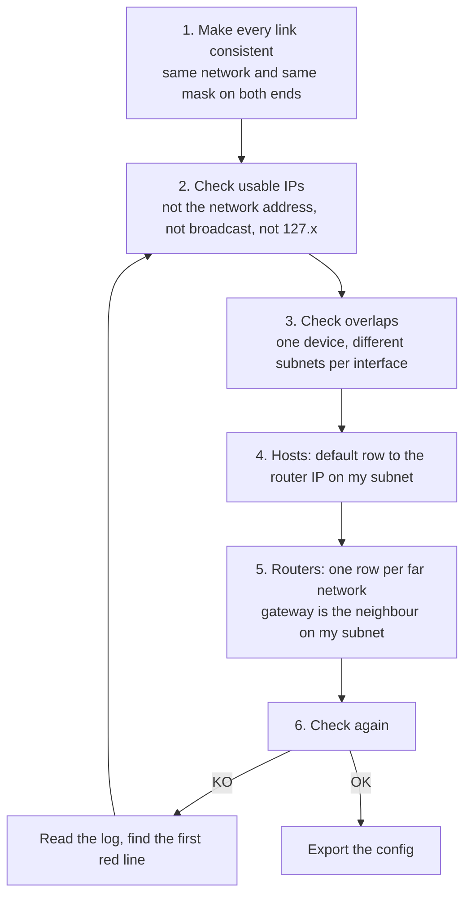
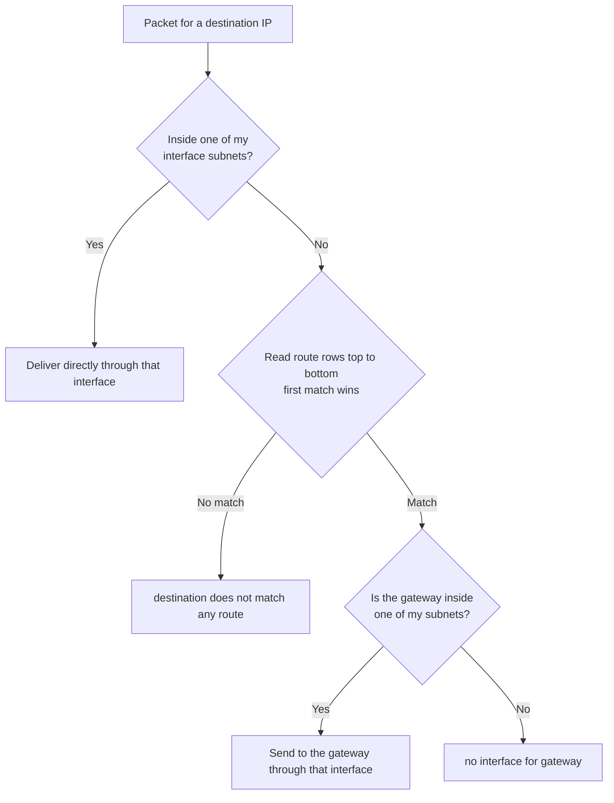
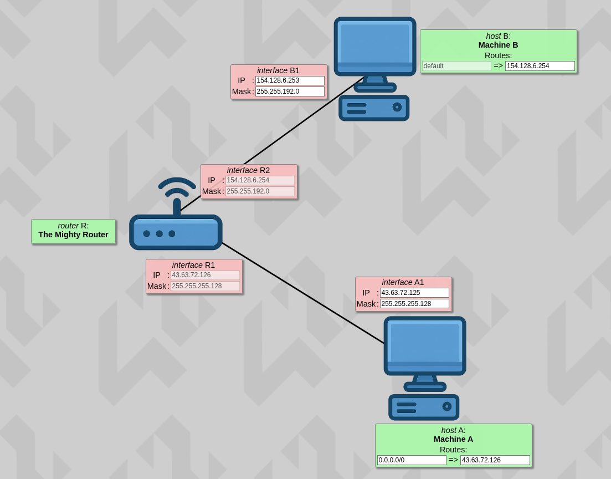
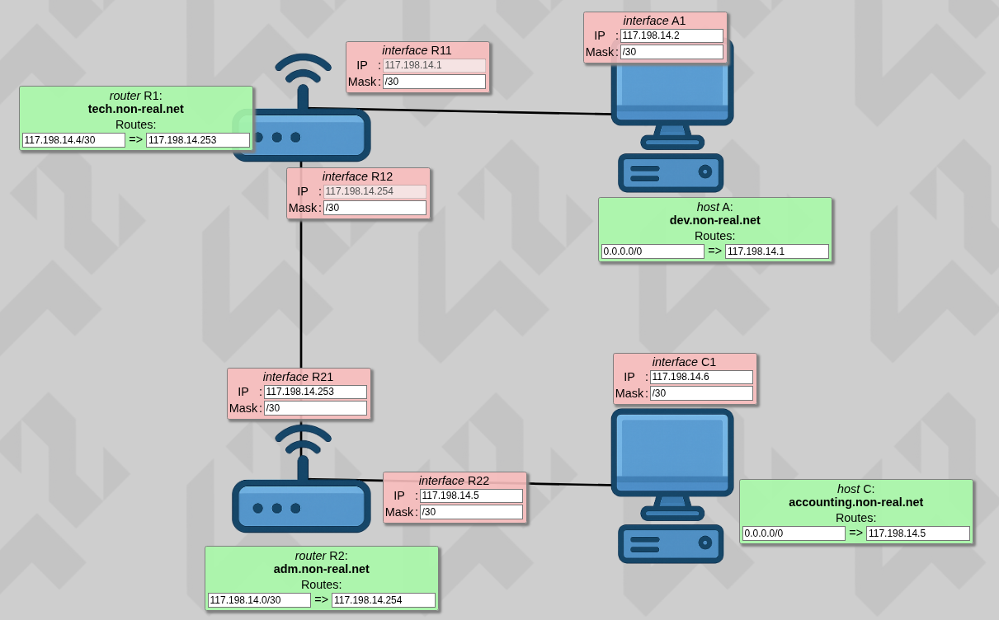
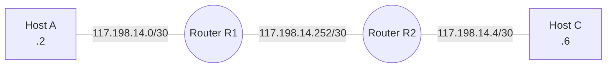
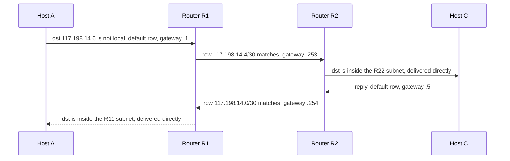
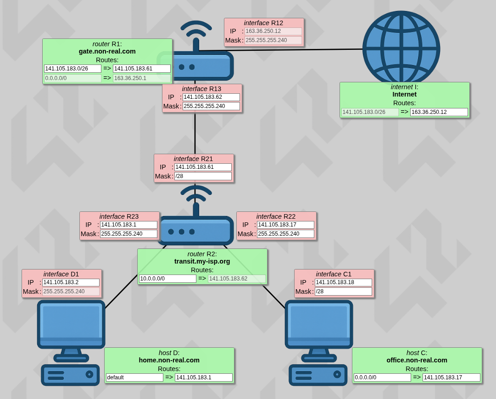
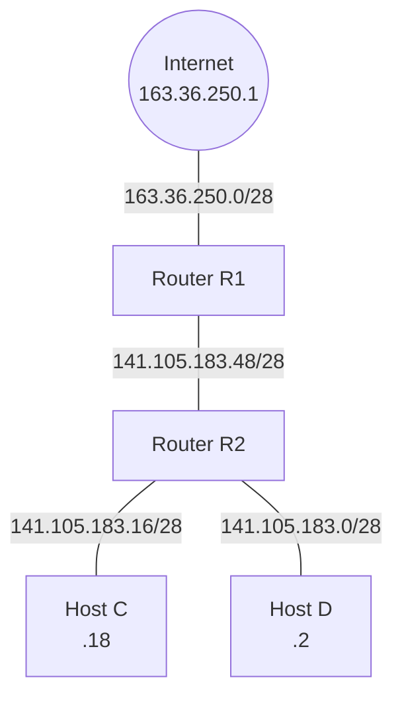

# NetPractice

**Subnetting, gateways and static routing: 10 broken simulated networks, fixed by hand.**

NetPractice is a networking exercise from the 42 curriculum. Each level shows a network that does not work: hosts, switches, routers and sometimes an "Internet" node. Some fields (IP addresses,masks, gateways, routing-table rows) are editable and some are locked. The job is to fill in the editable ones so that every goal (for example "host A must reach host C") succeeds, in both directions.

This repository contains my 10 exported configurations and a short guide to the method behind them.

```text
.
├── level1.json ... level10.json   # one exported configuration per level
├── img/                           # screenshots used in this README
└── README.md
```

## Run it

The training interface is provided by 42 for the curriculum, so it is **not included** in this repository. If you are a 42 student, download it from the project page, extract it, then:

```sh
./run.sh                      # starts a local web server and opens the browser
# fallback:
python3 -m http.server 49242  # then open http://localhost:49242
```

1. In the **Training** tab, enter your login and click **Start!** (the configuration of each level is generated from it).
2. Fix the editable fields (pink = interface IP and mask, green = routes).
3. Click **Check again** and read the log at the bottom if a goal fails.
4. When a level is OK, click **Get my config** to export it, then **Next level**.
5. Submission: the 10 exported files (one per level) go at the root of the repository.

The **Evaluation** tab generates random levels, which is how the defense works: three random levels, solved on a clock.

## How I solve a level

Subnets first, routes second. Never the other way round.



### How a device decides where to send a packet

This is the order the simulator follows, and it is the order I follow in my head.



### The 5 rules for routes

1. A **gateway** is the neighbour's IP, never my own IP.
2. The gateway must be inside one of **my own subnets**, because I can only hand a packet to something directly reachable.
3. The **destination** is a network I cannot reach directly (never my own subnet) and it must cover the target IP.
4. Rows are read top to bottom and **the first match wins**. A catch-all (`default` or `/0`) must be last.
5. A goal needs the **reverse way** too, so every device on the path needs a route back.

Short version: **destination = the network I can't see, gateway = the neighbour I can see.**

## Worked examples

### Level 5: two subnets, one router



| Segment | Network | Devices |
|---|---|---|
| A side | `43.63.72.0/25` (usable `.1`-`.126`) | A1 `.125`, R1 `.126` |
| B side | `154.128.0.0/18` (usable `154.128.0.1`-`154.128.63.254`) | B1 `154.128.6.253`, R2 `154.128.6.254` |

- A: `0.0.0.0/0 => 43.63.72.126` (the router interface on A's subnet).
- B: `default => 154.128.6.254` (the router interface on B's subnet).
- The router has no routes: it is directly attached to both subnets, so it already knows them.

### Level 7: a real addressing plan with /30 links



Three segments, each with exactly two devices, so each one is a `/30` (4 addresses, 2 usable, no waste).

| Segment | Network | Usable | Devices | Broadcast |
|---|---|---|---|---|
| A to R1 | `117.198.14.0/30` | `.1`-`.2` | R11 `.1`, A1 `.2` | `.3` |
| C to R2 | `117.198.14.4/30` | `.5`-`.6` | R22 `.5`, C1 `.6` | `.7` |
| R1 to R2 | `117.198.14.252/30` | `.253`-`.254` | R21 `.253`, R12 `.254` | `.255` |



| Device | Destination | Gateway | Why |
|---|---|---|---|
| A | `0.0.0.0/0` | `117.198.14.1` (R11) | its only way out |
| C | `0.0.0.0/0` | `117.198.14.5` (R22) | its only way out |
| R1 | `117.198.14.4/30` | `117.198.14.253` (R21) | C's network is behind R2 |
| R2 | `117.198.14.0/30` | `117.198.14.254` (R12) | A's network is behind R1 |

Packet path from A to C, and back:



### Level 8: splitting a /26 and reaching the Internet



The Internet node already routes `141.105.183.0/26` (64 addresses, `.0`-`.63`) back to my edge router, so everything internal must live inside that block. I cut it into `/28` blocks (16 addresses each). Masks are written both as dotted (`255.255.255.240`) and CIDR (`/28`) because the simulator accepts both.

| Block | Range | Use | Devices |
|---|---|---|---|
| `141.105.183.0/28` | `.0`-`.15` | D's LAN | R23 `.1`, D1 `.2` |
| `141.105.183.16/28` | `.16`-`.31` | C's LAN | R22 `.17`, C1 `.18` |
| `141.105.183.32/28` | `.32`-`.47` | spare | none |
| `141.105.183.48/28` | `.48`-`.63` | R1 to R2 link | R21 `.61`, R13 `.62` |



| Device | Destination | Gateway | Why |
|---|---|---|---|
| C | `0.0.0.0/0` | `141.105.183.17` (R22) | its only way out |
| D | `default` | `141.105.183.1` (R23) | its only way out |
| R2 | `10.0.0.0/0` | `141.105.183.62` (R13) | catch-all, its only way out (any IP with `/0` matches everything) |
| R1 | `141.105.183.0/26` | `141.105.183.61` (R21) | all internal networks are behind R2 |
| R1 (locked) | `0.0.0.0/0` | `163.36.250.1` | everything else goes to the Internet |
| Internet (locked) | `141.105.183.0/26` | `163.36.250.12` (R12) | the way back to my networks |

R1's `/26` row covers only my internal block, so `8.8.8.8` skips it and falls through to the default row toward the Internet.

## Mistakes that taught me the most

- **Level 8, `/0` in the wrong place.** I put a `/0` destination in R1's first row. It matched every IP, including `8.8.8.8`, so the packet went back to R2, then to R1 again, forever, and the locked default row below it was never used. Fix: `/26`, which covers only the internal block. A `/0` row is fine only as the last row.
- **Level 7, destination vs gateway.** I wrote each router's own network as the destination. A router is already attached to its own networks, so those rows never matched. The destination must be the network behind the neighbour.
- **Level 9, gateway equal to my own IP.** A row used the router's own interface as the gateway (`duplicate IP`). The gateway must be the neighbour's IP on my subnet.

## Subnetting cheat sheet

| Mask | CIDR | Block size | Usable hosts |
|---|---|---|---|
| 255.255.255.128 | /25 | 128 | 126 |
| 255.255.255.192 | /26 | 64 | 62 |
| 255.255.255.224 | /27 | 32 | 30 |
| 255.255.255.240 | /28 | 16 | 14 |
| 255.255.255.248 | /29 | 8 | 6 |
| 255.255.255.252 | /30 | 4 | 2 |

Partial mask octets: `128, 192, 224, 240, 248, 252` are worth 1, 2, 3, 4, 5, 6 extra bits, and block size = 256 minus that octet.

Finding a range in 4 steps:

1. **Cut octet**: the first mask octet that is not 255 and not 0.
2. **Block size**: 256 minus that mask octet.
3. **Network address**: the biggest multiple of the block size that is less than or equal to the IP's octet (octets after it become 0).
4. **Broadcast**: network + block size - 1 (octets after it become 255). Usable addresses are everything strictly between.

Example: `10.0.0.77/28` has block size 16, so the network is `.64`, the broadcast is `.79` and the usable range is `.65`-`.78`.

## Concepts

**TCP/IP addressing.** An IPv4 address is 32 bits, written as four octets (0-255). It identifies a device on a network and is split into a network part ("which street") and a host part ("which house").

**Binary.** Each octet is 8 bits worth `128 64 32 16 8 4 2 1`, so an octet goes from 0 to 255. Example: `00101101` = 32 + 8 + 4 + 1 = 45.

**Subnet mask and CIDR.** A mask marks which bits are the network part: 1s first, then 0s, never mixed. `/n` means the first n bits are network, so `/24` = `255.255.255.0`. Two devices are in the same subnet when they have the same network address and the same mask.

**Network, broadcast and usable addresses.** All host bits at 0 is the network address (the subnet itself). All host bits at 1 is the broadcast address (everyone on the subnet). Neither can be given to a device, so a subnet has 2^(host bits) - 2 usable addresses.

**Loopback.** The whole `127.0.0.0/8` block means "this machine". It is never a valid address for a host on a network.

**Default gateway.** The router interface, on my own subnet, that I send anything to when the destination is outside my subnet. It is the gateway of the `default` row.

**Routing table and static routes.** A list of rows, each `destination => gateway` ("to reach this network, hand the packet to this neighbour"). `default` (or `0.0.0.0/0`) means "any destination not matched earlier". `/0` means zero network bits, so any IP written before it matches everything. Rows are read top to bottom and only the first match is used.

**Forward and reverse way.** A goal passes only if the packet reaches the destination and the reply gets back to the source.

**Router.** Works at Layer 3 with IP addresses. It connects different networks, has one IP and mask per interface, and each interface must sit on a different subnet.

**Switch.** Works at Layer 2 with MAC addresses. It connects devices inside one network, passes frames to the right port, and has no IP role in the addressing.

| | Switch | Router |
|---|---|---|
| OSI layer | 2, Data link | 3, Network |
| Looks at | MAC address | IP address |
| Connects | devices inside one network | different networks |
| Decides with | MAC table (learned automatically) | routing table |
| Needs an IP config | no | yes, per interface |

**IP vs MAC.** The IP address is the final destination and stays the same end to end. The MAC address is the next stop and changes at every hop. That is why a host sends to its gateway: the frame carries the router's MAC while the far IP stays inside.

**OSI and TCP/IP models.** OSI is a 7-layer model used to explain networks. TCP/IP is the 4-layer model the Internet actually uses, and it groups OSI layers together.

| OSI | TCP/IP | Example |
|---|---|---|
| 7 Application, 6 Presentation, 5 Session | Application | HTTP, DNS, TLS |
| 4 Transport | Transport | TCP (reliable), UDP (fast) |
| 3 Network | Internet | IP, routers |
| 2 Data link, 1 Physical | Network access | Ethernet, switches, cables |

Mnemonic for OSI from 7 to 1: **A**ll **P**eople **S**eem **T**o **N**eed **D**ata **P**rocessing. NetPractice lives on layers 2 and 3.

## Reading the simulator logs

| Log says | Meaning | Fix |
|---|---|---|
| `destination does not match any interface. pass through routing table` | Not an error: the target is outside my subnets | none |
| `destination does not match any route` | No row covers the target IP | add or widen a row |
| `duplicate IP` | The gateway is my own IP | use the neighbour's IP |
| `route match but no interface for gateway` | The gateway is not inside any of my subnets | pick a gateway from my own subnet, check masks |
| `multiple interface match` | Two of my subnets overlap | shrink a mask |
| `invalid netmask` | The mask bits are not 1s then 0s | use a real mask |
| `loopback addresses` | A `127.x.x.x` address was used | pick a normal IP |
| `invalid default route on internet` | The Internet node rejects `default` and `0.0.0.0/0` | write a specific network, or another IP with `/0` |
| `loop detected` | The simulator cut a branch through a switch | harmless if `destination IP reached` appears |

---

*Project done by **simossd**.*